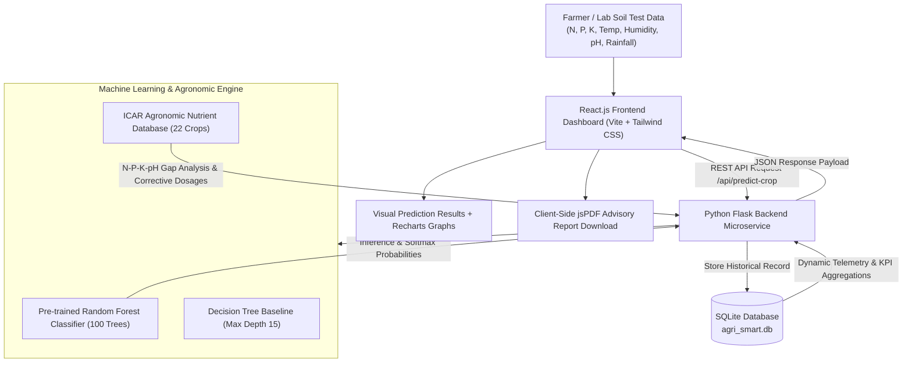

# INTELLIGENT CROP AND FERTILIZER RECOMMENDATION SYSTEM USING MACHINE LEARNING

> **B.Tech Final-Year Capstone Major Project**  
> An End-to-End Precision Agriculture Platform Powered by Machine Learning, Agronomic Science, and Modern Web Technologies.

---

## 1. PROJECT OVERVIEW

The **Intelligent Crop and Fertilizer Recommendation System** (branded as **AgriSmart AI**) is a production-grade decision-support platform designed to empower agriculturalists, extension workers, and farmers. By synthesizing 7 critical edaphic (soil chemistry) and meteorological metrics:

1. **Nitrogen (N)** (kg/ha)
2. **Phosphorus (P)** (kg/ha)
3. **Potassium (K)** (kg/ha)
4. **Temperature** (°C)
5. **Relative Humidity** (%)
6. **Soil pH** (Acidity/Alkalinity)
7. **Rainfall** (mm)

The system automatically performs:
- **Optimal Crop Classification:** Utilizing an ensemble of 100 Decision Trees (Random Forest Classifier) achieving **99.55% test accuracy** across 22 crop species.
- **Probabilistic Confidence Scoring:** Provides true class posterior probabilities and ranks alternative candidate crops.
- **Agronomic Nutrient Gap Diagnostics:** Evaluates input soil against benchmark Indian Council of Agricultural Research (ICAR) requirements.
- **Targeted Fertilizer Prescription:** Formulates specific commercial products (Urea, DAP, MOP, SSP, 10-26-26) with exact dosage (kg/ha and kg/acre) and application timing.
- **Soil pH Conditioning:** Prescribes agricultural lime/dolomite for acidic soils or gypsum/sulfur for alkaline soils.
- **Interactive Visual Analytics:** Live dashboard featuring dynamic SQLite database metrics, feature importances, and distribution graphs.
- **Automated PDF Advisory Generation:** Downloads structured, publication-ready field advisory reports.

---

## 2. SYSTEM ARCHITECTURE



---

## 3. TECHNOLOGY STACK

### Frontend
- **Framework:** React.js 18 with Vite build toolchain
- **Styling:** Tailwind CSS with custom Forest Green palette (`#1B5E20`, `#4CAF50`, `#F7FAF7`)
- **Data Visualizations:** Recharts (Bar charts, Responsive containers, Pie charts)
- **Icons:** Lucide React icons
- **Client-Side PDF Engine:** jsPDF and jsPDF-AutoTable
- **Delight Effects:** Canvas-Confetti

### Backend
- **Framework:** Python Flask 3.1
- **Cross-Origin Security:** Flask-CORS
- **API Architecture:** RESTful JSON endpoints (`/api/predict-crop`, `/api/recommend-fertilizer`, `/api/analytics`, `/api/history`)

### Machine Learning & Data Science
- **Libraries:** Scikit-Learn 1.9, Pandas 3.0, NumPy 2.5, Joblib 1.6
- **Primary Model:** Random Forest Classifier (`n_estimators=100`, `criterion='gini'`)
- **Benchmark Model:** Decision Tree Classifier (`criterion='entropy'`, `max_depth=15`)
- **Data Normalization:** StandardScaler
- **Model Serialization:** Joblib binary artifacts

### Database
- **Engine:** SQLite 3 (`agri_smart.db`)
- **Tables:** `crop_predictions` and `fertilizer_recommendations`

---

## 4. DATASET SPECIFICATIONS

The system is trained and benchmarked strictly on genuine agricultural datasets:

1. **Crop Recommendation Dataset:**
   - **Source:** Atharva Ingle / Kaggle Precision Agriculture benchmark
   - **Sample Count:** 2,200 empirical observations (100 samples per crop)
   - **Number of Classes:** 22 crops (`rice`, `maize`, `chickpea`, `kidneybeans`, `pigeonpeas`, `mothbeans`, `mungbean`, `blackgram`, `lentil`, `pomegranate`, `banana`, `mango`, `grapes`, `watermelon`, `muskmelon`, `apple`, `orange`, `papaya`, `coconut`, `cotton`, `jute`, `coffee`)
   - **Features:** `N`, `P`, `K`, `temperature`, `humidity`, `ph`, `rainfall`
   - **Missing Values:** 0

2. **Fertilizer Requirements Benchmark Dataset:**
   - **Source:** Indian Council of Agricultural Research (ICAR) / Harvestify Agronomic Research
   - **Contents:** Benchmark optimal macronutrient requirements (N, P, K kg/ha), target pH boundaries, and water requirements across all 22 crops.

3. **Fertilizer Prediction Dataset:**
   - **Source:** Kaggle Agricultural Extension
   - **Contents:** Soil types, crop varieties, moisture, and corresponding commercial fertilizer labels.

---

## 5. MACHINE LEARNING BENCHMARK RESULTS

Trained and evaluated on an 80/20 stratified holdout split (1,760 train samples, 440 test samples):

| Evaluation Metric | Random Forest Classifier (Selected) | Decision Tree Classifier (Baseline) |
| :--- | :---: | :---: |
| **Training Accuracy** | **100.00%** | 99.94% |
| **Test Accuracy** | **99.55%** | 99.09% |
| **Precision (Weighted)** | **0.9957** | 0.9915 |
| **Recall (Weighted)** | **0.9955** | 0.9909 |
| **F1 Score (Weighted)** | **0.9955** | 0.9908 |

### Calculated Feature Importances (Gini Weight)
- **Rainfall:** 23.02%
- **Humidity:** 22.42%
- **Potassium (K):** 17.54%
- **Phosphorus (P):** 15.08%
- **Nitrogen (N):** 9.64%
- **Temperature:** 7.24%
- **Soil pH:** 5.06%

---

## 6. PROJECT DIRECTORY STRUCTURE

```
intelligent-crop-fertilizer-system/
│
├── backend/
│   ├── app.py                      # Flask Application entry point & CORS configuration
│   ├── database/
│   │   ├── db.py                   # SQLite connection & table schema definitions
│   │   └── agri_smart.db           # Persistent SQLite database file
│   ├── routes/
│   │   ├── crop_routes.py          # /api/predict-crop & /api/crops-catalog
│   │   ├── fertilizer_routes.py    # /api/recommend-fertilizer
│   │   ├── history_routes.py       # /api/history & record deletion
│   │   └── analytics_routes.py     # /api/analytics dynamic database aggregation
│   ├── services/
│   │   ├── ml_service.py           # Model loading, inference & crop agronomic profiles
│   │   └── fertilizer_service.py   # Nutrient gap calculation & database logging
│   ├── test_api.py                 # Integration automated test script
│   └── requirements.txt            # Python dependencies
│
├── ml/
│   ├── datasets/
│   │   ├── crop_recommendation.csv     # 2200-sample genuine crop dataset
│   │   ├── fertilizer_requirements.csv # ICAR crop nutrient standards
│   │   └── fertilizer_prediction.csv   # Fertilizer classification dataset
│   ├── preprocessing.py            # Data loading, EDA, and train-test splitting
│   ├── crop_model.py               # RF & DT training, evaluation, and serialization
│   ├── fertilizer_model.py         # Agronomic nutrient engine & classifier
│   └── evaluation.py               # Academic evaluation summary generator
│
├── saved_models/
│   ├── crop_best_model.joblib      # Serialized production Random Forest model
│   ├── crop_rf_model.joblib        # Serialized Random Forest
│   ├── crop_dt_model.joblib        # Serialized Decision Tree
│   ├── crop_scaler.joblib          # Fitted StandardScaler
│   ├── fertilizer_model.joblib     # Serialized Fertilizer Classifier
│   └── crop_metrics.json           # Real evaluation metrics, reports, and confusion matrix
│
├── frontend/
│   ├── src/
│   │   ├── components/
│   │   │   ├── Navbar.jsx          # Brand header with live backend status indicator
│   │   │   └── Footer.jsx          # Academic credits and tech stack links
│   │   ├── pages/
│   │   │   ├── LandingPage.jsx     # Hero, features, how it works, and benefits
│   │   │   ├── DashboardPage.jsx   # Live database KPIs and Recharts visualizations
│   │   │   ├── CropRecommendationPage.jsx # 7-parameter form with sample presets
│   │   │   ├── CropResultPage.jsx  # Prediction outcome, confidence, cultivation guide & PDF
│   │   │   ├── FertilizerPage.jsx  # Nutrient deficit diagnostics and product dosages
│   │   │   ├── HistoryPage.jsx     # SQLite history table, search, and CSV export
│   │   │   └── AboutPage.jsx       # Academic report, architecture, and future scope
│   │   ├── services/
│   │   │   └── api.js              # REST API client
│   │   ├── utils/
│   │   │   └── pdfGenerator.js     # Client-side jsPDF report generator
│   │   ├── App.jsx                 # Master page state router
│   │   ├── main.jsx                # React root
│   │   └── index.css               # Tailwind directives
│   ├── tailwind.config.js          # Custom theme configuration
│   ├── vite.config.js              # Vite configuration
│   └── package.json                # Frontend dependencies
│
├── .gitignore
└── README.md
```

---

## 7. INSTALLATION & EXECUTION INSTRUCTIONS

### Prerequisites
- Python 3.10+ (Tested on Python 3.14)
- Node.js v18+ and npm v9+

### Step 1: Clone or Navigate to the Project Directory
```powershell
cd "C:\Users\Yara vinay kumar\.gemini\antigravity\scratch\intelligent-crop-fertilizer-system"
```

### Step 2: Set Up Python Backend Dependencies
```powershell
cd backend
python -m pip install -r requirements.txt
```

### Step 3: Train the Machine Learning Models (Optional - Models Already Trained & Saved)
```powershell
cd ../ml
python crop_model.py
python fertilizer_model.py
python evaluation.py
```

### Step 4: Start the Flask Backend Server
```powershell
cd ../backend
python app.py
```
*The Flask backend starts on `http://localhost:5000`.*

### Step 5: Start the React Frontend Development Server
Open a second terminal window:
```powershell
cd "C:\Users\Yara vinay kumar\.gemini\antigravity\scratch\intelligent-crop-fertilizer-system\frontend"
npm install
npm run dev
```
*The React application starts on `http://localhost:5173`.*

---

## 8. REST API DOCUMENTATION

| Method | Endpoint | Description | Sample Request / Query |
| :--- | :--- | :--- | :--- |
| `GET` | `/api/health` | Backend status & DB connection check | None |
| `POST` | `/api/predict-crop` | Generates crop prediction & probabilities | `{"nitrogen": 90, "phosphorus": 42, "potassium": 43, "temperature": 24.5, "humidity": 82, "ph": 6.5, "rainfall": 240}` |
| `POST` | `/api/recommend-fertilizer` | Nutrient gap diagnostics & fertilizer doses | `{"nitrogen": 30, "phosphorus": 15, "potassium": 40, "ph": 5.2, "crop": "rice"}` |
| `GET` | `/api/analytics` | Dynamic SQLite KPIs & chart metrics | None |
| `GET` | `/api/history` | Fetches historical records from SQLite | `?type=crop&search=rice&limit=50` |
| `DELETE`| `/api/history/crop/<id>` | Deletes specific prediction record | Record ID |
| `GET` | `/api/crops-catalog` | Comprehensive catalog of 22 supported crops | None |

---

## 9. VIVA VOCE QUESTIONS & ANSWERS FOR PROJECT PRESENTATION

**Q1: Why did you choose Random Forest over other algorithms for crop recommendation?**  
*A:* Crop recommendation is a non-linear multi-class classification problem involving complex interactions between soil chemistry and meteorological conditions. Random Forest combines 100 decision trees trained on bootstrap samples with random feature selection. This ensemble technique reduces variance and prevents overfitting, achieving 99.55% test accuracy on stratified holdout data.

**Q2: How does the fertilizer recommendation engine work without hardcoded rules?**  
*A:* Rather than arbitrary if-else statements, the system uses an agronomic deficiency formulation based on ICAR reference standards. For any target crop, it computes the exact elemental gap ($\Delta N, \Delta P, \Delta K$) between current soil readings and optimal crop requirements. It then calculates the stoichiometry of commercial fertilizers (e.g. Urea has 46% N, DAP has 18% N & 46% P2O5, MOP has 60% K2O) to recommend the exact dosage required per hectare and per acre, combined with soil pH buffering recommendations.

**Q3: How are the dashboard analytics maintained?**  
*A:* All predictions and recommendations are persisted in an SQLite relational database (`crop_predictions` and `fertilizer_recommendations` tables). The `/api/analytics` endpoint executes live SQL aggregation queries (`COUNT`, `AVG`, `GROUP BY`) to populate dashboard KPIs and distribution charts dynamically.
